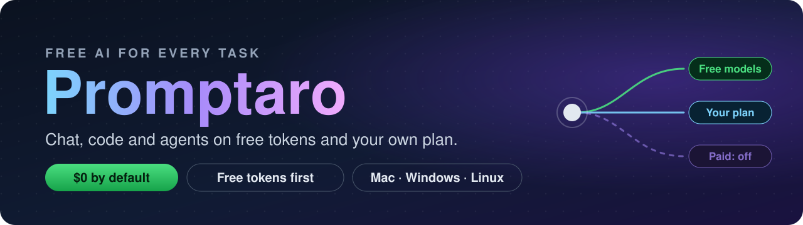
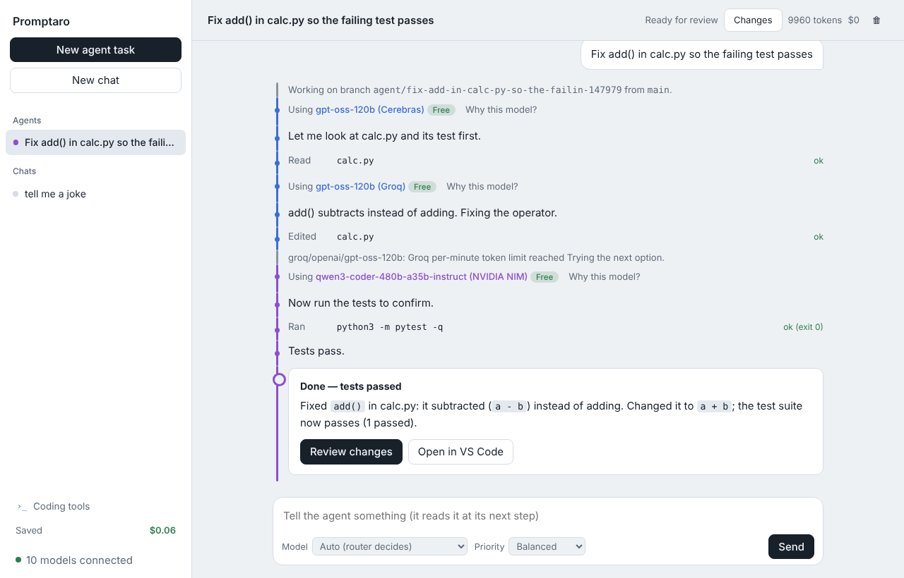
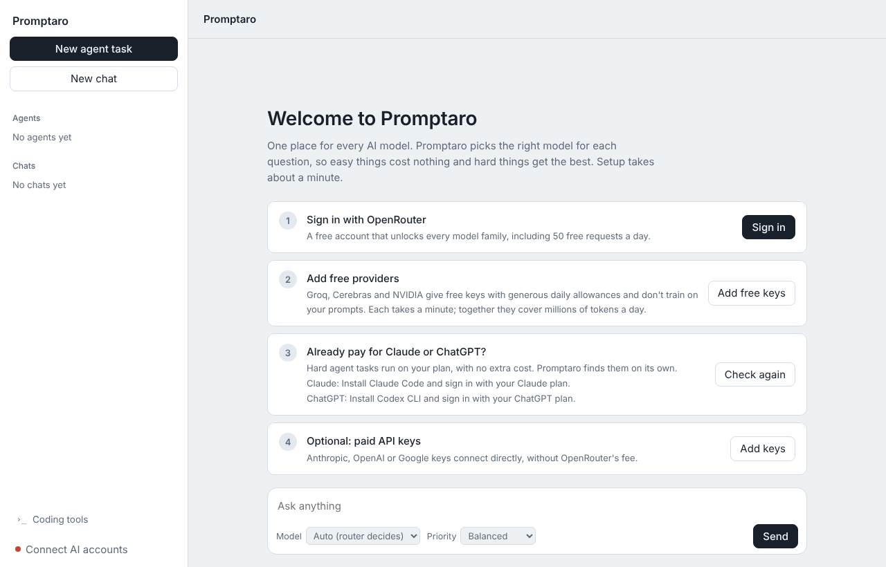
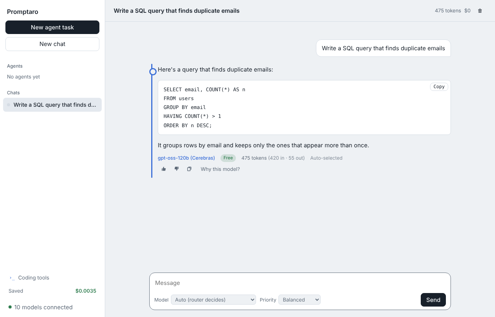
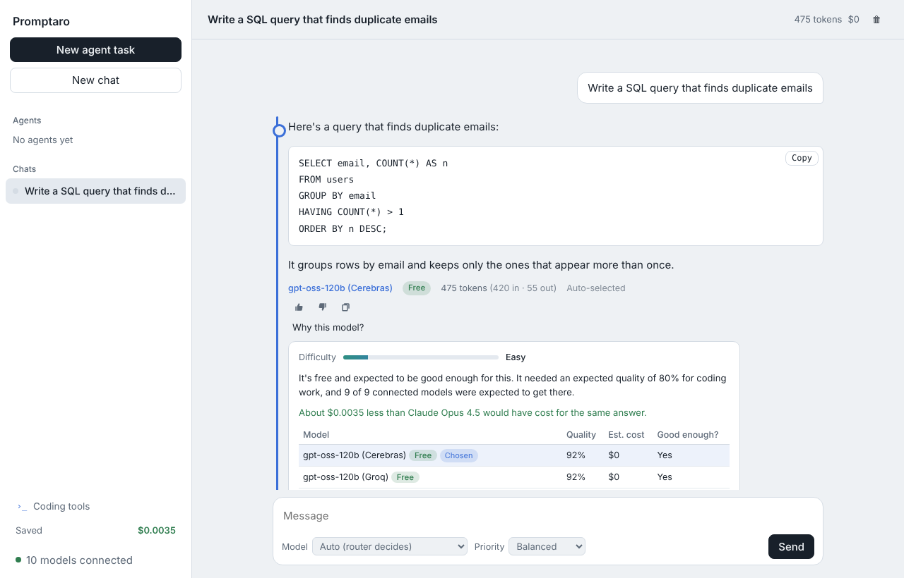
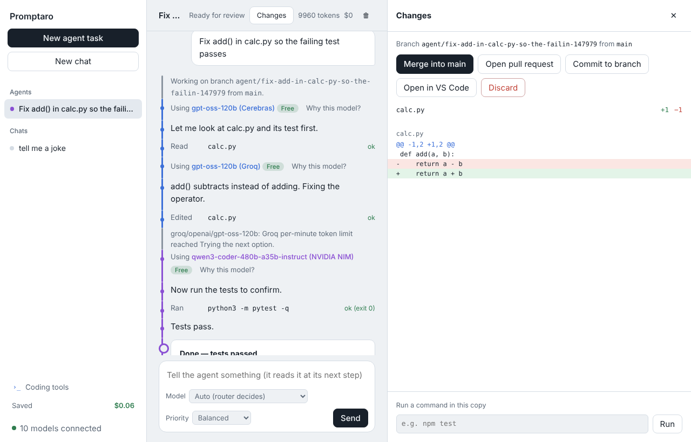
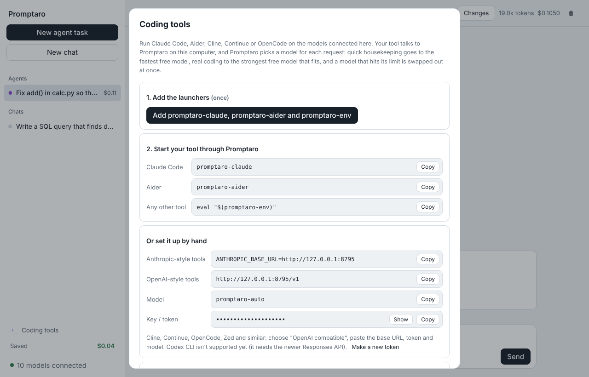
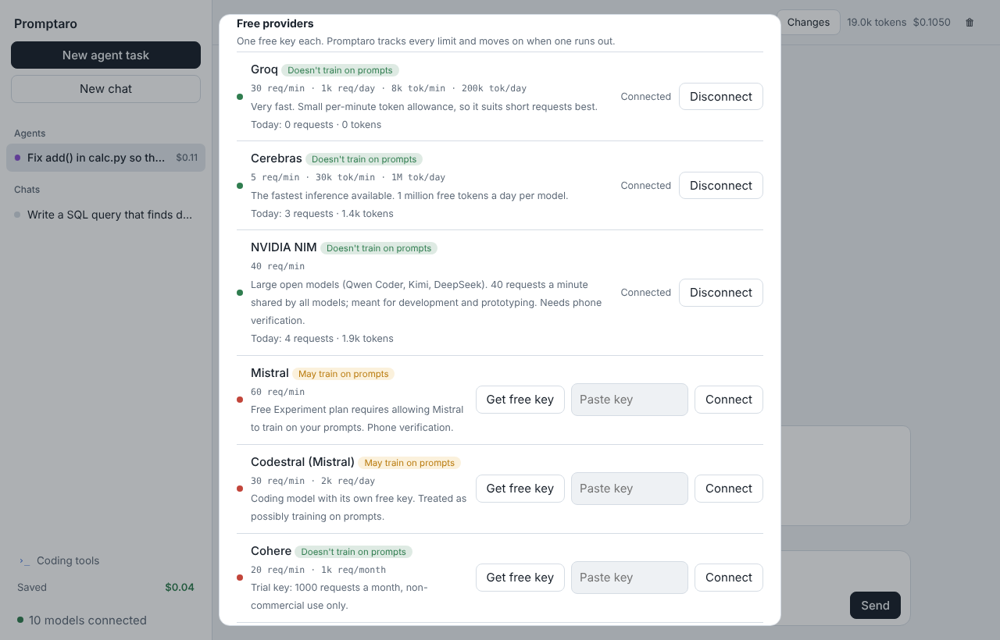
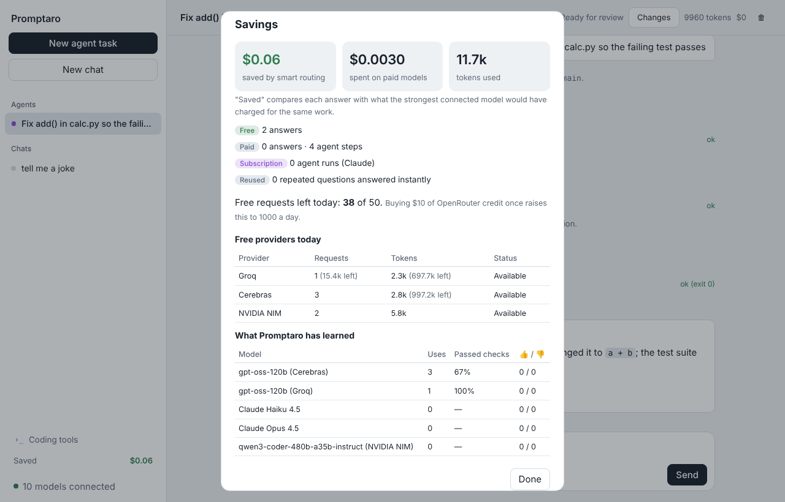
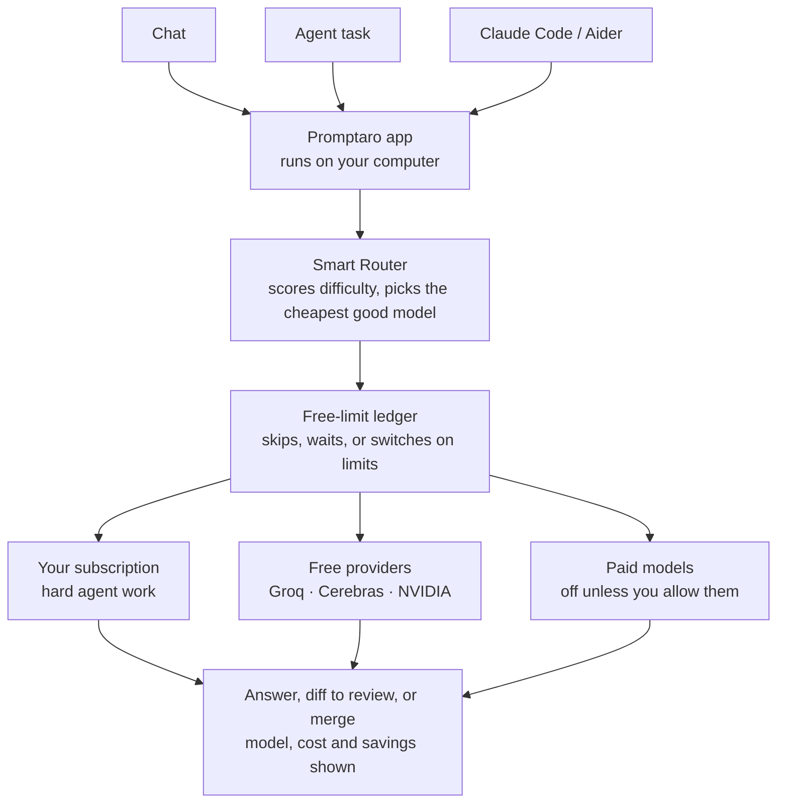

<p align="center">
  
</p>

<p align="center">
  <b>A desktop app by Akshay Dubey for AI-powered chats, coding, and agent tasks.</b><br>
  Uses free AI tokens first and the Claude or ChatGPT plan you already have. <b>It never spends money unless you turn that on.</b>
</p>

<p align="center">
  <a href="LICENSE"></a>
  <a href="https://www.python.org/downloads/"></a>
  
  <a href=".github/workflows/tests.yml"></a>
  
  
</p>

<p align="center">
  <a href="#-quick-start">Quick Start</a> ·
  <a href="#-what-you-get">Features</a> ·
  <a href="#-0-by-default">$0 by default</a> ·
  <a href="#-how-it-works">How it works</a> ·
  <a href="#-free-providers">Free providers</a> ·
  <a href="#-coding-tools">Coding tools</a> ·
  <a href="#-privacy-and-safety">Privacy</a>
</p>

<p align="center">
  <a href="docs/images/06-agent-run.png"></a><br>
  <sub><i>An agent fixes a failing test for $0. When Groq hits its per-minute limit, Promptaro switches to NVIDIA on its own.</i></sub>
</p>

---

## ✨ What you get

- **One app for every AI model.** Chat with Claude, GPT, Gemini, Llama, Qwen, DeepSeek and more, side by side, with answers streaming in as they're written.
- **$0 by default.** Promptaro only uses free AI tokens and the subscription you already pay for. Paid per-use models stay off unless you switch them on.
- **The right model for every message.** A built-in Smart Router scores each request in under a millisecond, without calling a model. Everyday questions go to free models; hard work goes to your Claude or ChatGPT plan if you have one.
- **Free tokens first.** Plug in free keys from Groq, Cerebras and NVIDIA, and Promptaro tracks every per-minute, daily and monthly limit, moving to the next model before you ever see an error.
- **Your existing plans, put to work.** Signed in to Claude Code or Codex CLI? Hard chats and agent tasks run on your Claude or ChatGPT subscription, at no extra cost.
- **Coding agents you stay in control of.** Each agent works on its own git branch in a separate copy of your repo. It reads, edits and runs your tests, then waits for you to review the diff and merge.
- **Free models inside your coding tools.** `promptaro-claude` and `promptaro-aider` start Claude Code and Aider on free models, with no setup.
- **Every choice explained.** Each answer shows the model, Free or Paid, tokens and cost. **Why this model?** shows what was considered and how much was saved.
- **Studio.** Generate images on free tiers, and convert PDFs, images, audio, video and documents locally.
- **Install with one double-click** on Mac, Windows and Linux. No terminal, no build steps.

## 💸 $0 by default

Promptaro is built to save you money. It follows three rules:

| You have | What Promptaro uses | What it costs |
|---|---|---|
| **No subscription** | Free models only: Groq, Cerebras, NVIDIA, OpenRouter's free models, Ollama on your computer | **$0** |
| **Claude Pro/Max or ChatGPT Plus/Pro** | Free models for everyday questions, your plan for hard questions and when free models can't answer | **$0 extra**, it's your plan |
| **Paid models switched on** (optional) | Paid per-use models only when free models and your plan can't help, up to a daily cap you set | Only what you allow |

- **Nothing paid by surprise.** If a free answer fails, Promptaro tries another free model or your plan. It never quietly moves up to a paid model.
- **Paid models are locked** in the model menu until you tick **Allow paid models** in Connections.
- **When nothing free is left** (every free limit used up), it tells you when limits reset and how to add more free keys, instead of spending.
- **Fewer tokens per message.** Promptaro only sends its own help text when you ask about the app.

## 🚀 Quick Start

Download or clone this repository, then double-click one file. Promptaro installs itself and opens in your browser.

| | Double-click this | What happens |
|---|---|---|
| **Mac** | `promptaro/Install Promptaro.command` | Installs **Promptaro.app** into Applications and opens it. From then on it's a normal app: Spotlight, Launchpad, Dock. |
| **Windows** | `promptaro/Install Promptaro.bat` | Adds **Promptaro** to the Start menu and desktop, and starts it. |
| **Linux** | `promptaro/packaging/install-linux.sh` | Adds **Promptaro** to your app menu and starts it. |

**Runs on** macOS 11 or newer (Intel and Apple Silicon), Windows 10/11 and Linux. The launcher installs and manages Python for you.

The first start takes about a minute while it sets itself up. After that it opens instantly and keeps running in the background; **Connections → Quit Promptaro** stops it.

> [!NOTE]
> The Mac app isn't Apple-signed yet. If macOS refuses to open it, right-click the file and choose **Open**.

<details>
<summary><b>Run it without installing</b></summary>

Double-click **Start Promptaro** in the `promptaro` folder (`.command` on Mac, `.bat` on Windows). Or, from a terminal in this folder:

```bash
# Mac
open "promptaro/Start Promptaro.command"
# Linux
./promptaro/launch.sh
```

```powershell
# Windows (PowerShell): the quotes and the & are needed because the name has a space
& ".\promptaro\Start Promptaro.bat"
```

The two folders, `promptaro/` and `smart-router/`, must stay side by side.
</details>

### First run

<p align="center">
  <a href="docs/images/01-onboarding.png"></a><br>
  <sub><i>Setup shows each step's live status: sign in with OpenRouter, add free providers, and Promptaro finds your Claude or ChatGPT plan on its own.</i></sub>
</p>

## 🖼️ A quick tour

<table>
  <tr>
    <td width="50%"><a href="docs/images/03-streaming.png"></a><br><sub><b>Chat.</b> Every answer shows which model wrote it, whether it was free, and the tokens used.</sub></td>
    <td width="50%"><a href="docs/images/04-why.png"></a><br><sub><b>Why this model?</b> How hard the request looked, the models compared, and the money saved.</sub></td>
  </tr>
  <tr>
    <td width="50%"><a href="docs/images/07-review.png"></a><br><sub><b>Review.</b> See the agent's diff, then merge, open a pull request, or discard.</sub></td>
    <td width="50%"><a href="docs/images/08-coding-tools.png"></a><br><sub><b>Coding tools.</b> Run Claude Code, Aider and more on free models.</sub></td>
  </tr>
  <tr>
    <td width="50%"><a href="docs/images/09-free-providers.png"></a><br><sub><b>Free providers.</b> Each one's limits, today's usage, and whether it may train on your prompts.</sub></td>
    <td width="50%"><a href="docs/images/10-savings.png"></a><br><sub><b>Savings.</b> Spent vs saved, and what the router has learned about each model.</sub></td>
  </tr>
</table>

## 🧭 How it works



If a model hits a limit or fails before it starts replying, the request moves to the next one, so you don't see an error. When an agent keeps failing, it moves one step up to a stronger model, never straight to the most expensive one.

## 🆓 Free providers

Add one free key per provider in **Connections**. Promptaro reads each provider's own rate-limit headers and pauses a provider when it says no.

| Provider | Free tier | Trains on prompts? | Good for |
|---|---|---|---|
| [Groq](https://console.groq.com/keys) | 30 req/min, 1k req/day, 8k tokens/min per model | No | Very fast short requests |
| [Cerebras](https://cloud.cerebras.ai/platform) | 5 req/min, 30k tokens/min, 1M tokens/day per model | No | Fastest inference, big daily allowance |
| [NVIDIA NIM](https://build.nvidia.com/settings/api-keys) | 40 req/min per account | No | Large open models (Qwen Coder, Kimi, DeepSeek) |
| [Mistral](https://console.mistral.ai/api-keys) | 60 req/min | May train | Chats only, unless you allow code |
| [Codestral](https://console.mistral.ai/codestral) | 30 req/min, 2k req/day | May train | Chats only, unless you allow code |
| [Cohere](https://dashboard.cohere.com/api-keys) | 1k req/month, non-commercial | No | Occasional use |
| [OpenRouter](https://openrouter.ai) | 50 free req/day (1k after a one-time $10 top-up) | Varies by model | Every model family in one sign-in |

Together, Groq, Cerebras and NVIDIA give roughly 2–4 million private tokens a day. Limits change; the app shows the date each one was checked.

**Custom endpoints:** add any OpenAI-compatible API by base URL (Ollama, LM Studio, vLLM or a company proxy). Ollama running on your computer is picked up automatically.

## 💻 Coding tools

Open **Coding tools** in the sidebar and click **Add promptaro-claude, promptaro-aider and promptaro-env** once. Then, in any terminal:

```
promptaro-claude                 # Claude Code on free models
promptaro-aider                  # Aider on free models
eval "$(promptaro-env)"          # Any other tool: Cline, Continue, OpenCode, Zed
```

By default coding tools **never spend money**. Code only goes to providers that don't train on prompts unless you allow it.

## 💳 Your subscriptions

| Plan | Tool | How it's detected |
|---|---|---|
| Claude Pro / Max | **Claude Code** | `claude auth status` shows a Claude account sign-in |
| ChatGPT Plus / Pro / Business | **Codex CLI** | `codex login status` shows "Logged in using ChatGPT" |

When either is signed in, hard agent tasks run on that plan. If a plan hits its usage limit, Promptaro rests it for an hour and hands the work to the other plan or to free models. Promptaro never reads or stores either login.

## 🔒 Privacy and safety

- **Runs on your computer.** The app listens on `127.0.0.1` only and refuses requests from websites.
- **Keys stay in your system keychain** and are never shown again.
- **Credential files are off limits.** `.env` files, SSH keys and certificates are never shown to any model.
- **Agents can't escape their folder.** They work on their own branch in a separate copy, and risky commands wait for your **Allow**.
- **No surprise spending.** Paid models are off by default. If you turn them on, a daily cap and a per-task budget limit them.

## 📁 Repository layout

| Folder | What it is |
|---|---|
| [`promptaro/`](promptaro/README.md) | The desktop app: chat, agents, review, Studio, launchers and installers. |
| [`smart-router/`](smart-router/README.md) | The engine: model scoring, free-limit ledger, failover, learning, and the local gateway for coding tools. |

<details>
<summary><b>Run the tests</b></summary>

```
cd smart-router && python -m pytest -q     # 112 tests
cd promptaro && python -m pytest -q        # 140 tests
```

Every push runs both suites on macOS, Windows and Linux with Python 3.12 and 3.13.
</details>

<details>
<summary><b>Coming from Tillwright?</b></summary>

Promptaro was previously called Tillwright. The first run moves `~/.tillwright` and `~/.akshay-router` into `~/.promptaro` (keys, settings, sessions and worktrees) without overwriting anything. The old `tw-claude`, `tw-aider` and `tw-env` commands keep working. Set `PROMPTARO_NO_MIGRATE=1` to opt out.
</details>

## 📄 License

Copyright © 2026 Akshay Dubey. All rights reserved. Proprietary; see [LICENSE](LICENSE).

Promptaro is an independent project and isn't affiliated with Anthropic, OpenAI, Google or any model provider. Product names belong to their owners.
